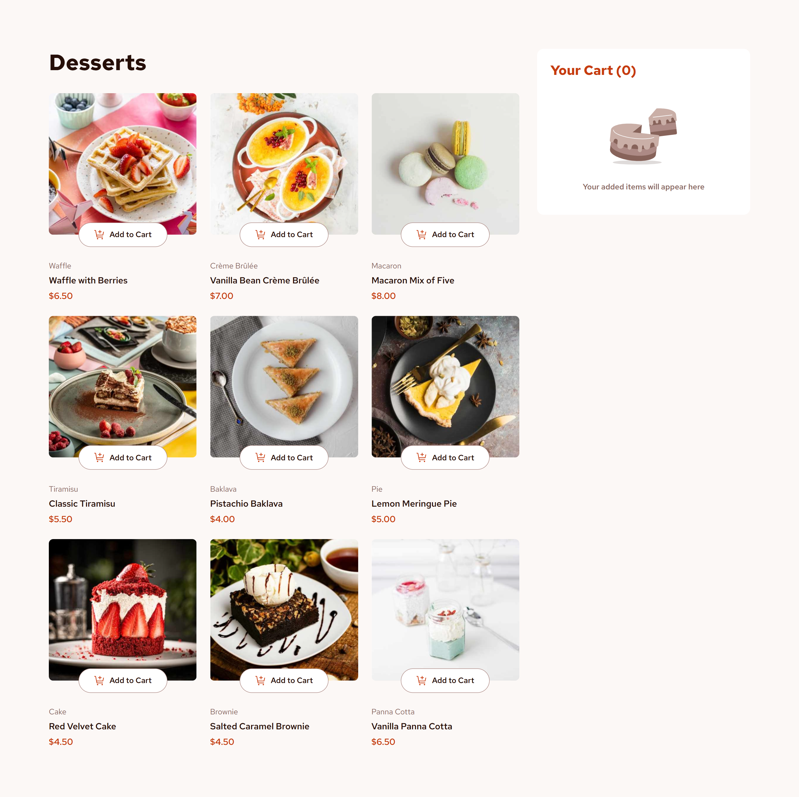
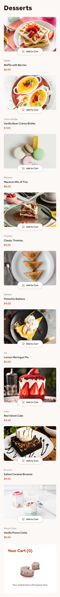
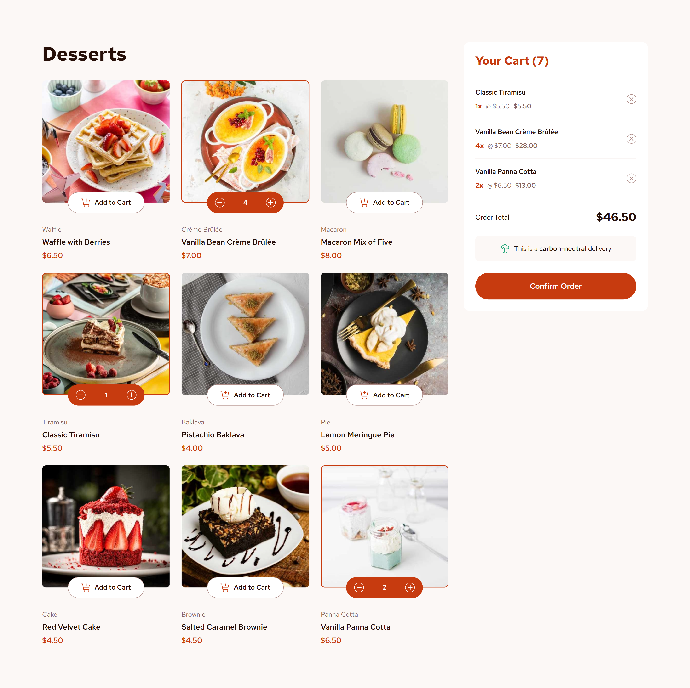
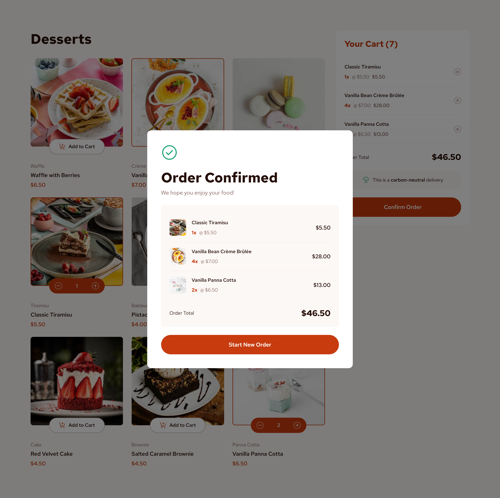

# Product List with Cart

A solution to the [Product list with cart](https://www.frontendmentor.io/challenges/product-list-with-cart-5MmqLVAp_d) challenge on Frontend Mentor, rebuilt from scratch with a focus on a small design system: tokens, reusable components and accessibility.



**Live demo:** https://tvixaley.github.io/product-list-with-cart-ts/

## Features

- Add desserts to the cart, change quantity with a stepper, remove items
- Live cart counter, per-item totals and order total
- Order confirmation modal built on the native `<dialog>` element (Esc and backdrop click close it)
- "Start New Order" clears the cart
- Responsive layout: 1 column on mobile, 2 on tablet, 3 + sidebar cart on desktop
- Responsive images via `<picture>` (mobile / tablet / desktop sources)

## Tech stack

- React 19 + TypeScript
- Vite
- CSS Modules + CSS custom properties (no UI libraries)
- `vite-plugin-svgr` for SVG icons as components
- State: `useReducer` + Context (separate contexts for state and dispatch)

## Design system

All visual decisions live in `src/styles/tokens.css`:

- **Colors:** primitive palette (`--rose-*`, `--red`, `--green`) and semantic tokens on top of it (`--color-accent`, `--color-surface`, `--color-text-secondary`, ...)
- **Spacing:** 4px-based scale (`--space-50` ... `--space-1100`)
- **Typography:** `text-preset-*` utility classes built from size / line-height / weight tokens
- **Radius, borders, transitions:** tokens as well, with `prefers-reduced-motion` support

Components never use raw values, only tokens, so a theme change means editing one file.

### Reusable components

| Component | Purpose |
| --- | --- |
| `Button` | Primary button with hover and `:focus-visible` states |
| `QuantityControl` | "Add to Cart" button that turns into a +/- stepper |
| `OrderLine` | One order row, `cart` variant (with remove) and `summary` variant (with thumbnail) |
| `OrderTotal` | "Order Total" row shared by the cart and the modal |

`OrderLine` uses a discriminated union for its props, so `onRemove` is required for `cart` and not allowed for `summary`.

## Accessibility

- Semantic structure: `main`, `section`, `aside`, lists for products and order lines
- Icon-only buttons have `aria-label`, decorative images have empty `alt`
- Quantity changes are announced via `aria-live="polite"`
- Focus is preserved when `QuantityControl` switches between "Add to Cart" and the stepper
- Visible `:focus-visible` styles on interactive elements
- Modal uses native `<dialog>` with `showModal()`, so focus trapping and Esc come for free
- Page scroll is locked while the modal is open

## Project structure

```
src/
  app/          # App layout
  components/   # Button, Cart, OrderLine, OrderTotal, ProductCard, ...
  context/      # cart reducer, providers, hooks
  data/         # desserts.json and typed product list
  lib/          # formatPrice
  styles/       # tokens, reset, fonts, globals
  types/
```

## Getting started

```bash
npm install
npm run dev
```

Other scripts:

```bash
npm run build     # production build
npm run preview   # preview the build locally
```

## What I learned

- Splitting primitive and semantic design tokens
- Extracting shared UI (`Button`, `OrderLine`) instead of duplicating CSS between the cart and the modal
- Typing component variants with discriminated unions
- Managing focus manually when an element is replaced in the DOM
- Working with the native `<dialog>` element in React

## Screenshots

| Mobile                                  | Cart with items                     | Order confirmed                       |
| --------------------------------------- | ----------------------------------- | ------------------------------------- |
|  |  |  |
